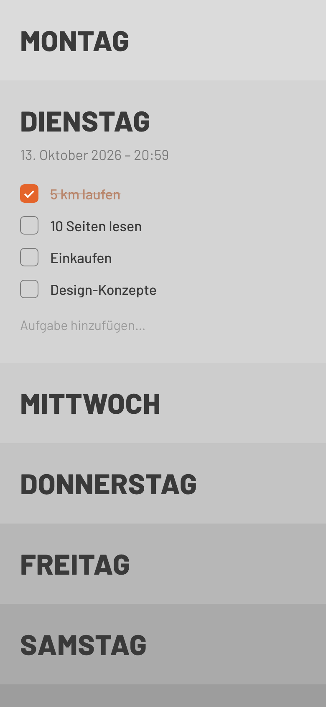
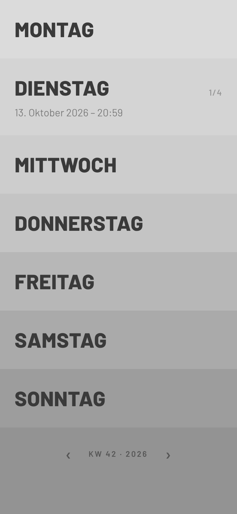

# Orbit

Eine minimalistische Life-Tracking-App. Version 1 ist ein Wochen-Planer im Stil von [weekstack.io](https://weekstack.io/): sieben gestapelte Tagesbänder von hell nach dunkel. Ein Tag wird angetippt, klappt auf und zeigt seine Aufgaben.

| Heute aufgeklappt | Woche |
| --- | --- |
|  |  |

## Was der erste Entwurf kann

- Woche von Montag bis Sonntag, beim Start ist der heutige Tag aufgeklappt (mit Datum und Uhrzeit)
- Tag antippen zum Auf- und Zuklappen, es ist immer nur einer offen
- Aufgaben hinzufügen (Return), abhaken (Tippen) und löschen (lange drücken)
- Zugeklappte Tage zeigen den Fortschritt dezent rechts (`1/4`)
- Unten zwischen den Wochen blättern (KW-Anzeige, „Zurück zu heute“)
- Wird lokal auf dem Gerät gespeichert (AsyncStorage), mit Haptik-Feedback auf iOS/Android

## Starten

```bash
npm install
npx expo start
```

Dann den QR-Code mit der **Expo Go**-App auf dem iPhone scannen. Im Browser geht es mit `npx expo start --web`.

## Struktur

```
App.tsx                    Fonts laden, Safe Area, Startscreen
src/theme.ts               Farben, Schrift, Abstände (hier wird der Look justiert)
src/lib/date.ts            Wochen- und Datumslogik (deutsch)
src/lib/useTasks.ts        Aufgaben-State und Speicherung
src/screens/WeekScreen.tsx Der Wochen-Stack
src/components/            DayRow, TaskItem, Checkbox, WeekFooter
```

Was als Nächstes kommt und welche Skills du dafür brauchst, steht in [docs/ROADMAP.md](docs/ROADMAP.md).
