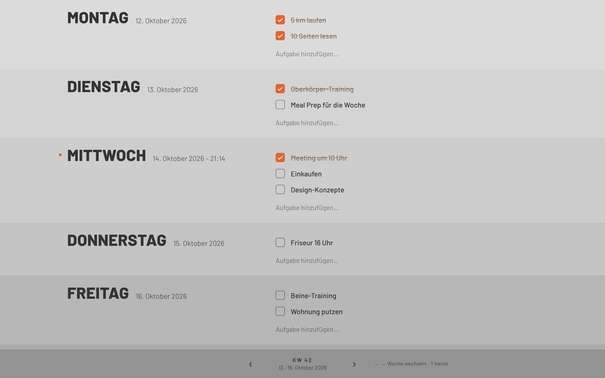

# Orbit

Eine minimalistische Life-Tracking-App fürs Handy **und** den PC, dein privater Manager statt zehn einzelner Apps.

- **Start:** ein ruhiger Sperrbildschirm: links ein unscharfer Statuenkopf, rechts ORBIT. Du entsperrst am Handy, indem du die Leiste nach rechts wischst, am PC mit **gedrückter Leertaste**.
- **Startseite:** Begrüßung, dann dein Tag aufgeteilt in **Habits** (jeden Tag dasselbe abhaken) und **Todos** (Aufgaben für heute), darunter die kommenden Werkzeuge. Die Seitenleiste (am Handy über das Menü-Symbol) führt zu allen Seiten.
- **Habits:** jeden Tag eine frische Liste mit Kästchen, aufgebaut wie die Todos. Welche Habits an welchen Wochentagen anstehen, legst du in den Einstellungen fest. Dazu die Serie („10 Tage in Folge“).
- **Todos:** ein Wochen-Planer im Stil von [weekstack.io](https://weekstack.io/), sieben gestapelte Tagesbänder von hell nach dunkel. Jede Aufgabe kann ein „Bis“-Datum (dann steht sie jeden Tag bis dahin drin), gearbeitete Stunden, einen Link und Tags haben.
- **Einstellungen:** Habits anlegen und festlegen, an welchen Tagen sie sich wiederholen; Tags (z. B. Schule) anlegen, umbenennen und löschen.

**Am PC** liegt die ganze Woche offen da, links der Tag, rechts die Aufgaben:



**Am Handy** tippst du einen Tag an, er klappt auf:

| Heute aufgeklappt | Woche |
| --- | --- |
|  |  |

## Was die Todos können

- Woche von Montag bis Sonntag, heute mit Datum und Uhrzeit
- Ein Tag ist offen (beim Start heute), ein Klick auf einen anderen Tag klappt diesen auf und die übrigen zu, am Handy wie am PC
- Neue Aufgabe: „+ Aufgabe hinzufügen“, das Plus unten (am Handy schwebend unten rechts) oder die Taste **N**
- Abhaken mit dem Kästchen, danach fragt eine kleine Zeile nach den gearbeiteten **Stunden** (½, 1, 2, 3 oder eine eigene Zahl, überspringen geht)
- Ein Klick auf die Beschreibung öffnet ein kleines Fenster (am PC rechts über der Liste, am Handy von unten) mit:
  - **Bis:** die Aufgabe steht jeden Tag bis dahin in der Liste, wird pro Tag abgehakt und ist am letzten Tag orange markiert („Fällig“, danach „Überfällig“)
  - **Stunden:** für den Tag, plus Summe über alle Tage
  - **Link:** einfügen und mit einem Klick öffnen
  - **Tags:** z. B. Schule, Arbeit, Privat
  - Schließen mit × oder **Escape**, löschen mit „Aufgabe löschen“
- Zwischen den Wochen blättern, am PC auch mit den Tasten **←** **→**, **T** springt zu heute
- Speichert lokal: am Handy auf dem Gerät, am PC im Browser
- Ab 860 px Inhaltsbreite (Fenster ohne Seitenleiste) automatisch das PC-Layout, darunter das Handy-Layout

## Am PC starten

Einmalig [Node.js](https://nodejs.org/) (LTS-Version) installieren. Dann im Projektordner:

```bash
npm install
npm run web
```

Danach öffnet sich Orbit im Browser, meist unter http://localhost:8081.

## Online stellen (Render)

Orbit im Browser besteht nur aus fertigen Dateien (`dist/`), dafür braucht es keinen Server. Auf Render deshalb als **Static Site** anlegen, nicht als Web Service: Static Sites sind kostenlos, schlafen nie ein und zeigen keinen „Service waking up“-Bildschirm.

1. [Render Dashboard](https://dashboard.render.com/) → **New** → **Blueprint** → dieses Repo wählen. Render liest `render.yaml` und legt die Static Site „orbit“ an (Build: `npm ci && npm run build:web`, Ordner: `dist`).
2. Einen alten **Web Service** für Orbit löschen (Service → Settings → Delete), sonst bleibt dessen Adresse beim Lade-Bildschirm hängen.

Jeder Push auf `main` baut die Seite automatisch neu.

## Am Handy starten

```bash
npm run start
```

Den QR-Code mit der App **Expo Go** (iPhone/Android) scannen.

## Mit Claude Code weiterbauen

Das Repo ist für [Claude Code](https://claude.ai/code) eingerichtet:

- **`CLAUDE.md`** enthält die Projektregeln: Design-Prinzipien, beide Layouts (Handy + PC), Deutsch als UI-Sprache und die Prüfbefehle. Claude liest sie bei jeder Session automatisch.
- **`.claude/hooks/session-start.sh`** installiert in Cloud-Sessions (claude.ai/code) automatisch alle Pakete.
- **CI** (`.github/workflows/ci.yml`) prüft jeden Pull Request: Typecheck, Lint, Web-Build.

Beispiel-Prompts für die nächsten Schritte:

> „Füge eine minimalistische Navigation hinzu: Woche · Training · Essen. Gleicher Graustufen-Look, am PC und am Handy.“

> „Baue den Trainingsplan-Editor: Pläne mit Übungen, Sätzen, Wiederholungen und Gewicht. Übungen sollen sich per Drag & Drop sortieren lassen.“

## Prüfen

```bash
npm run typecheck   # TypeScript
npm run lint        # ESLint
npm run build:web   # Web-Build nach dist/
```

## Struktur

```
src/app/_layout.tsx        Fonts, Sperrbildschirm, App-Hülle
src/app/index.tsx          Startseite (Willkommen, Habits und Todos von heute, Werkzeuge)
src/app/habits.tsx         Habits als Tagesliste mit Serie
src/app/todos.tsx          Der Wochen-Planer
src/components/gate/       Sperrbildschirm und Wisch-Leiste zum Entsperren
src/components/shell/      Seitenleiste, Schublade fürs Handy, Kopfzeile
assets/lock/               Statuenkopf (Original und unscharfe Fassung, siehe scripts/make-lock-image.py)
src/app/einstellungen.tsx  Einstellungen (Habits, Tags)
src/components/            DayBand, TaskList, TaskItem, TaskPanel, DatePicker, HabitItem, Checkbox, WeekFooter
src/lib/date.ts            Wochen- und Datumslogik (deutsch)
src/lib/storage.ts         Lokales Speichern (gemeinsam für Todos und Habits)
src/lib/useTasks.ts        Todos (Bis, Stunden, Link, Tags)
src/lib/useTags.ts         Tags
src/lib/useTaskPanel.ts    Welche Aufgabe im Fenster offen ist
src/lib/useHabits.ts       Habits und Serien
src/lib/useLayout.ts       Handy- oder PC-Layout je nach Fensterbreite
src/theme.ts               Farben, Schrift, Abstände (hier wird der Look justiert)
public/index.html          HTML-Hülle für den Browser
```

Was als Nächstes kommt und welche Skills du dafür brauchst, steht in [docs/ROADMAP.md](docs/ROADMAP.md).
